<p align="right">
  <strong>English</strong> · <a href="README.zh-CN.md">Chinese</a>
</p>

<picture>
  <source media="(max-width: 600px) and (prefers-color-scheme: dark)" srcset="assets/profile/hero-dark-mobile.svg">
  <source media="(max-width: 600px) and (prefers-color-scheme: light)" srcset="assets/profile/hero-light-mobile.svg">
  <source media="(prefers-color-scheme: dark)" srcset="assets/profile/hero-dark.svg">
  <source media="(prefers-color-scheme: light)" srcset="assets/profile/hero-light.svg">
  
</picture>

I build systems that help robots **perceive and reconstruct the world**, and tools that make working with code a little better.

<p>
  <a href="https://dapengfeng.github.io/"><samp>[website]</samp></a> &nbsp;
  <a href="#-ls-projects"><samp>[projects]</samp></a> &nbsp;
  <a href="https://github.com/DapengFeng/DapengFeng/discussions"><samp>[say hello]</samp></a>
</p>

### `$ git log --author=DapengFeng -5`

<!--RECENT_COMMITS:START-->
- `2026-11-07` `DapengFeng/dapengfeng.github.io` · [`d32ef1a`](https://github.com/DapengFeng/dapengfeng.github.io/commit/d32ef1a613d974754a4ba80d43577c1cdb0b7437) — [feat: add classical Chinese and English typography](https://github.com/DapengFeng/dapengfeng.github.io/commit/d32ef1a613d974754a4ba80d43577c1cdb0b7437)
- `2026-11-07` `DapengFeng/dapengfeng.github.io` · [`c988376`](https://github.com/DapengFeng/dapengfeng.github.io/commit/c988376d55077b11c26e3ad2b86f829cf5f07426) — [feat: automate daily mathematics inventory reminders](https://github.com/DapengFeng/dapengfeng.github.io/commit/c988376d55077b11c26e3ad2b86f829cf5f07426)
- `2026-11-06` `DapengFeng/dapengfeng.github.io` · [`35168d8`](https://github.com/DapengFeng/dapengfeng.github.io/commit/35168d89e9bdfcad88e63bc8fba544e622316dc0) — [feat: add futures guide and replenish daily mathematics](https://github.com/DapengFeng/dapengfeng.github.io/commit/35168d89e9bdfcad88e63bc8fba544e622316dc0)
- `2026-11-06` `DapengFeng/dapengfeng.github.io` · [`c872e3f`](https://github.com/DapengFeng/dapengfeng.github.io/commit/c872e3f9011c91c313d4e7d08fa9727e834b6563) — [fix: clarify financial statements part one prose](https://github.com/DapengFeng/dapengfeng.github.io/commit/c872e3f9011c91c313d4e7d08fa9727e834b6563)
- `2026-11-02` `DapengFeng/N3` · [`7807f63`](https://github.com/DapengFeng/N3/commit/7807f63e975a1c7624bc79ff362f55abb434dcfa) — [Initial commit](https://github.com/DapengFeng/N3/commit/7807f63e975a1c7624bc79ff362f55abb434dcfa)

<sub>Dates: UTC+08:00 · Up to 20 recently pushed public repositories scanned · Default branches only.</sub>
<!--RECENT_COMMITS:END-->

<sub>Scheduled refresh: hourly.</sub>

### `$ ls projects/`

<details>
<summary><samp><strong>cartgs/</strong></samp> — 3D Gaussian splatting SLAM · IEEE RA-L</summary>

<br>

**CaRtGS** — Real-time photorealistic SLAM with 3D Gaussian Splatting. Pixels in, a reconstructed world out.

[<samp>[source]</samp>](https://github.com/DapengFeng/cartgs) &nbsp; [<samp>[paper]</samp>](https://arxiv.org/abs/2410.00486) &nbsp; [<samp>[demos]</samp>](https://dapengfeng.github.io/cartgs/)

</details>

<details>
<summary><samp><strong>S3E/</strong></samp> — Collaborative SLAM dataset · IEEE RA-L</summary>

<br>

**S3E** — A multi-robot dataset bringing together LiDAR, stereo cameras, IMU, and UWB. Mapping is a multiplayer problem.

[<samp>[repository]</samp>](https://github.com/DapengFeng/S3E) &nbsp; [<samp>[paper]</samp>](https://arxiv.org/abs/2210.13723) &nbsp; [<samp>[dataset]</samp>](https://dapengfeng.github.io/S3E/)

</details>

<details>
<summary><samp><strong>RustCxx/</strong></samp> — Rust ideas, C++20 syntax</summary>

<br>

**RustCxx** — Rust-style enums, `Result`, and `Option` in a header-only C++20 library. C++ asked for options. I gave it `Option`.

[<samp>[source]</samp>](https://github.com/DapengFeng/RustCxx)

</details>

### `$ cat notes/index`

- [<samp>pytorch-internals/</samp>](https://dapengfeng.github.io/series/pytorch-internals/) — following tensors behind the scenes.
- [<samp>travel-notes/</samp>](https://dapengfeng.github.io/blog/?category=travel) — places, photos, and observations outside the terminal.

<details>
<summary><samp>$ cat profile.json</samp></summary>

<br>

```json
{
  "name": "Dapeng Feng",
  "interests": [
    "Computer vision",
    "Robotics",
    "Computer graphics"
  ],
  "languages": ["Python", "C++"],
  "tools": [
    "PyTorch", "OpenCV", "ROS",
    "Linux", "Git", "CMake", "LaTeX"
  ]
}
```

</details>

<details>
<summary><samp>$ cat education.log</samp></summary>

<br>

- **Ph.D. · Computer Science and Technology**<br>Sun Yat-sen University · 2021 – 2026
- **Master's · Pattern Recognition and Intelligent Systems**<br>Sun Yat-sen University · 2018 – 2021
- **Bachelor's · Computer Science and Technology**<br>Guangdong University of Foreign Studies · 2014 – 2018

</details>

<details>
<summary><samp>$ cat .rubber-duck.log</samp></summary>

<br>

```text
DUCK   What does T_wc map?
ROBOT  Camera -> world.
DUCK   Where is your input point?
ROBOT  World.

[one inverse later]

ROBOT  Oh.
```

</details>

<details>
<summary><samp>$ ./contribution-snake</samp></summary>

<br>

```text
[warn] Something is eating the commits.
```

<picture>
  <source media="(prefers-color-scheme: dark)" srcset="profile-snake-contrib/github-contribution-grid-snake-dark.svg">
  <source media="(prefers-color-scheme: light)" srcset="profile-snake-contrib/github-contribution-grid-snake.svg">
  
</picture>

</details>

---

<samp>dapeng@github:~$</samp> **[say hello](https://github.com/DapengFeng/DapengFeng/discussions)**

A paper question, a strange bug, a half-formed idea — all welcome. Especially if it involves 3D vision, SLAM, robotics, or making developers' lives easier.
